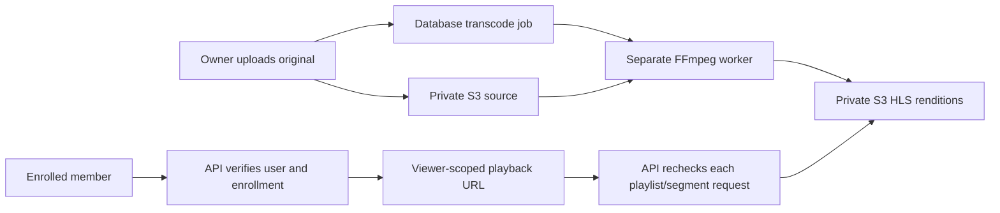

# Custom video transcoding and protected S3 playback

Videos use our FFmpeg worker and a private S3 bucket. Bunny Stream and Mux are not used. FFmpeg is software we run ourselves; worker compute, S3 storage/requests, and video delivery still have costs.



## Deploy

1. Back up the database and apply migrations with `npm run db:deploy`. The new migration queues existing private videos in the media library. It does not copy, overwrite, or delete their originals. Unregistered S3 recordings must first be imported into the library.
2. Configure the API's public base URL, e.g. `API_PUBLIC_URL=https://api.example.com`. This must point at this API, not the frontend or bucket. Configure `FRONTEND_URLS` for browser CORS.
3. Configure `S3_BUCKET`, `S3_REGION`, and an IAM role or AWS credentials. Keep S3 Block Public Access enabled for source and `transcoded/` objects. Any CDN for public images must serve only the `public/` prefix.
4. Build the application, then run the API and a **separate video worker** using the same environment and database:

   ```sh
   npm run build
   npm start
   # Separate process/container:
   npm run video:worker:start
   ```

   During development, use `npm run video:worker` instead. FFmpeg and ffprobe must be installed on that worker. `FFMPEG_PATH` and `FFPROBE_PATH` can point to local binaries. The Docker image includes FFmpeg and runs as the non-root `node` user; override its command to `node dist/jobs/transcode.worker.js` for the worker service.

5. Allow worker `GetObject` for originals, `PutObject`/`GetObject`/`DeleteObject` for its `transcoded/` prefix, and bucket `ListBucket` scoped to that prefix. The API needs its existing media-upload permissions plus `GetObject` for HLS playlists and segments and list/delete for media cleanup. No object ACL is made public.
6. Provision ephemeral disk for the source **plus all outputs**. Defaults allow a 5 GiB source and 10 GiB output per active job, plus overhead. The worker processes one job at a time with two FFmpeg threads; run more worker containers to increase concurrency. Use a restricted container without privileged mounts, keep FFmpeg patched, and limit worker CPU/memory/disk at the host/container layer.

## Upload and processing

Use the existing small or direct multipart upload APIs. Video-library creation and its queued job are a single database operation, including multipart completion and import. File bytes never pass through Redis, and jobs remain queued while workers are offline.

- Status: `GET /v1/admin/media/:id/transcode` (owner authentication required).
- Queue a legacy video or retry a failed job: `POST /v1/admin/media/:id/transcode` with `{}`. Ready and actively processing jobs cannot be replaced through this endpoint.
- Attach it to a session using `videoMediaId`, or attach it as a course/session resource using `mediaId`.
- Status progression: `queued` → `processing` → `ready`, or `failed` after attempts are exhausted. A failed attempt is retried with backoff. Status responses expose a safe error code, not parser output or local paths.
- Uploading/attaching is allowed while processing; member playback URLs remain null until ready. The source never becomes a member-video fallback.

The worker checks source size, probes actual video metadata, normalizes to H.264/AAC, and generates 6-second MPEG-TS HLS segments. It produces 360p, 720p, and 1080p when appropriate, capped by source dimensions; smaller sources get a smaller rendition. It preserves aspect ratio, supports silent videos, and does not upscale above source display dimensions. It accepts common uploaded video containers, not arbitrary playlists or network URLs.

Output is stored under `transcoded/<media-id>/<attempt-id>/`. Each attempt has a new prefix. All rendition segments/playlists are uploaded before the master playlist and before the job becomes ready. Failed partial output is cleaned; cleanup failures retain the prefix for retry/deletion. Originals are retained for recovery and future re-encoding.

## Member playback and resources

`GET /v1/sessions/:id` still requires bearer authentication and an active paid enrollment. A processed video now returns:

```json
{
  "playbackType": "hls",
  "processingStatus": "ready",
  "playbackUrl": "https://api.example.com/v1/playback/<media-id>/master.m3u8?token=<signed-grant>",
  "playbackUrlExpiresAt": "2026-10-24T12:00:00.000Z"
}
```

The fields live inside the API's normal `data` envelope. While a video is queued, processing, or failed, `playbackUrl` is null and `processingStatus` describes why. Video resources expose the same HLS fields through their `media` object. PDFs, downloadable audio, and other resources keep private S3 download URLs; those links are capped to 15 minutes and the remaining enrollment period.

Use an HLS-capable frontend player: native HLS where supported, or a player such as hls.js. The query token means playlist/segment requests do not need to carry the main bearer token. On playback-token expiration, call the authenticated session/course endpoint again and refresh the player URL, preserving the current position. Do not render a plain MP4 player for an HLS URL in browsers without HLS support.

Each playlist/segment request validates the signed grant, its audience, the current user token version, the recording/resource attachment, active enrollment, payment status, and processing state. Original storage keys and output prefixes are not included in member responses. Playlists are rewritten so every child URL goes through the API. A segment request then redirects to a private S3 URL valid for **at most 60 seconds**, further capped by enrollment and token expiry. Video bytes travel directly from S3 to the viewer.

Playback responses use `Cache-Control: private, no-store`; do not configure a proxy/CDN to cache these redirects or manifests publicly. Configure access logs at the load balancer/CDN to redact playback query tokens too. Browser S3 CORS must permit your frontend origins, GET/HEAD, and Range headers (the existing multipart upload CORS also permits PUT).

## Recovery and deletion

Workers claim database rows with `FOR UPDATE SKIP LOCKED`, renew a 90-second lease every 15 seconds, and publish readiness only while holding their own lease. A crashed job is reclaimed after lease expiration. If a database connection fails while publishing readiness, the worker verifies the commit before cleanup; it retains output when the outcome is unknown. Graceful shutdown stops the encoder and leaves the job retryable. Runtime, duration, thread count, source size, output size, and parser stdout are bounded; child processes receive no AWS/API credentials and never run through a shell.

Detach recordings/resources before deleting media. Actively processing media returns HTTP 409 on deletion. For ready/failed/queued media, deletion prevents new claims/attachments, removes the recorded output prefix and original, then removes the library record. Failed deletion leaves a tombstone; list with `includeDeleting=true` and retry the deletion. If infrastructure fails after a stale worker loses its lease, monitor `transcoded/` for orphaned **attempt** prefixes and clean only prefixes no longer referenced by a job. Do not add a blanket lifecycle deletion rule over ready transcoded videos. Incomplete source multipart uploads should retain their existing abort-after-one-day lifecycle rule.

## Configuration defaults

| Variable | Default |
| --- | --- |
| `API_PUBLIC_URL` | `http://localhost:3001` (set the HTTPS API base in deployment) |
| `FFMPEG_PATH`, `FFPROBE_PATH` | `ffmpeg`, `ffprobe` on PATH |
| `VIDEO_MAX_DURATION_SECONDS` | 14400 (4 hours) |
| `VIDEO_MAX_OUTPUT_BYTES` | 10737418240 (10 GiB) |
| `VIDEO_TRANSCODE_TIMEOUT_SECONDS` | 21600 (6 hours total per job) |
| `VIDEO_TRANSCODE_THREADS` | 2 |
| `VIDEO_TRANSCODE_ATTEMPTS` | 3 |
| `VIDEO_PLAYBACK_TTL_SECONDS` | 3600, capped by enrollment expiration |

Run `npm test` for authorization, worker failure/lease, source validation, playlist rewriting, and encoding checks. Real FFmpeg tests generate and decode short fixtures if FFmpeg/ffprobe are available; CI installs them explicitly. No real customer recording, S3 upload, or production database is used by these tests. Rehearse migrations and exercise actual S3 upload, multi-worker claims, browser CORS, seeking, logout/refund revocation, and cleanup in staging before deployment.

This implements recorded adaptive playback, not live streaming or DRM. A viewer who can watch can still capture content. Revoking access prevents new API grants immediately; already-issued S3 segment URLs can remain usable for up to 60 seconds, and bytes already downloaded cannot be recalled.

References: [FFmpeg HLS muxer](https://ffmpeg.org/ffmpeg-formats.html#hls), [S3 presigned URLs](https://docs.aws.amazon.com/AmazonS3/latest/userguide/using-presigned-url.html).
